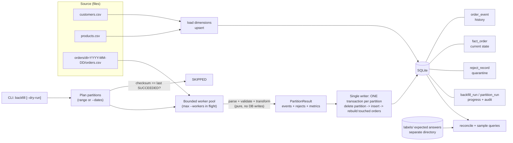

# Partition Backfill Pipeline

Controlled **historical backfill** of selected date partitions with **dry-run estimates, bounded parallelism,
idempotent writes, progress tracking and safe restart** - Python 3.11 + SQLite, **standard library only** (pytest for tests).

Domain: e-commerce **order events** (`CREATED -> PAID -> SHIPPED ...`), loaded from daily CSV partitions into a history
table, a current-state table, a reject/quarantine table and run/partition audit tables.

> [`docs/design_tradeoffs.md`](docs/design_tradeoffs.md) (trade-offs), [`docs/data_dictionary.md`](docs/data_dictionary.md) (schemas),
> [`docs/ai_usage/`](docs/ai_usage) (AI disclosure + prompt history), [`reports/`](reports) (execution evidence).

## 1. Quick start (clean environment)
```bash
python3 -m venv .venv && source .venv/bin/activate      # Windows: .venv\Scripts\activate
pip install -r requirements.txt                         # only pytest; runtime needs nothing
python -m pytest                                        # 69 tests
bash scripts/run_demo.sh                                # full demo + regenerates reports/ (Linux/macOS/WSL/Git-Bash)
```
Windows without bash: run the commands in section 3 manually. Requires Python 3.9+ (developed and tested on 3.12, SQLite 3.45;
window functions and `ON CONFLICT` need SQLite >= 3.25).

## 2. Architecture

Flow in words: **plan** (skip already-loaded unchanged partitions) -> **workers** parse/validate partitions in parallel (never more
than `--workers` in flight) -> **one writer** commits each partition atomically -> failures are recorded per attempt, transient
ones retried with backoff -> **reconcile** proves source == target.

Modules (`backfill/`): `schemas` (contract) - `validate` (pure rules + transforms) - `worker` (parse one partition) -
`loader` (atomic idempotent load) - `dimensions` - `db` (DDL + audit helpers) - `orchestrator` (plan, dry-run, pool, retry,
restart) - `reconcile` / `reports` - `datagen` (synthetic data + labels) - `cli`.

## 3. Commands
```bash
# generate data (fixed seed => byte-identical output); labels go to a SEPARATE directory
python -m backfill generate --out data/sample --labels-out data/sample_labels --seed 42 --days 7 --orders-per-day 120
python -m backfill generate --out out/large/src --labels-out out/large/labels --days 30 --orders-per-day 1800 \
       --customers 5000 --products 500 --no-special-partitions            # ~143k rows ("make generate-large")

# 1) estimate first - writes nothing
python -m backfill backfill --db out/warehouse.db --source data/sample --start 2024-03-01 --end 2024-03-07 --dry-run
# 2) run (range or explicit dates)
python -m backfill backfill --db out/warehouse.db --source data/sample --start 2024-03-01 --end 2024-03-07 --workers 4
python -m backfill backfill --db out/warehouse.db --source data/sample --dates 2024-03-03,2024-03-04 --force
# 3) observe / prove
python -m backfill status    --db out/warehouse.db
python -m backfill reconcile --db out/warehouse.db --source data/sample --labels data/sample_labels --out reports
python -m backfill report    --db out/warehouse.db --sql sql/sample_queries.sql --out reports/sample_query_results.md
```
Useful flags: `--workers N` (hard cap on concurrent partitions) - `--max-retries` / `--retry-backoff` - `--batch-size` -
`--force` - `--simulate-failure DATE[:N]` (demo: fail the first N attempts of a partition *mid-transaction*) - `--report-dir`.
Exit codes: `0` all good - `2` some partitions failed (`PARTIAL`/`FAILED`) - `1` usage/run-level error - `3` reconciliation failed.

## 4. How each requirement is met
| Requirement | Where / how |
|---|---|
| Selected date partitions | `--start/--end` or `--dates`; one folder per day |
| **Dry-run estimates** | `--dry-run`: rows, bytes, would-run / would-skip / would-fail (incl. schema problems), reject-rate from a sample, time estimate (calibrated from earlier runs when available). Target DB opened **read-only**; test proves nothing is written |
| **Bounded parallelism** | `ProcessPoolExecutor(max_workers=N)` with a sliding window (never more than N submitted); test asserts the bound |
| **Idempotent writes** | partition overwrite in one transaction, deterministic reject ids; tests: skip, forced rerun, corrected file, order-independence |
| **Progress tracking** | `partition_run` (every attempt) + `backfill_run` + `v_partition_progress` + `status` command + per-partition log line `[k/N]` |
| **Safe restart** | rerun same command: unchanged `SUCCEEDED` partitions skipped via SHA-256; crashed attempts -> `ABANDONED`; failure mid-transaction rolls back (tested) |
| Schemas, keys, assumptions | [`docs/data_dictionary.md`](docs/data_dictionary.md) |
| Sample + scalable generator | `backfill/datagen.py` (seeded); small committed sample in `data/sample`, large run via `make generate-large` |
| Ingest, validate, transform, publish | `worker.py` -> `validate.py` -> `loader.py` |
| Rejects / quarantine / duplicates | `reject_record` with file, line, reason, raw row; `DUPLICATE_EVENT` and `CONFLICTING_DUPLICATE` |
| Metrics & failure reasons | run id, start/end, read/accepted/rejected/duplicate/late counts, `error_type`/`error_message` per attempt |
| Tests (happy, empty, malformed, duplicates, nulls, >=2 domain edge cases) | `tests/` - 69 tests (see below) |
| Reconciliation / validation report | `reports/reconciliation.md` (15 checks incl. row-level comparison to labels) |
| Performance measurement + optimisation | `scripts/benchmark.py` -> `reports/performance.md` |
| Labels separate from input | `data/sample_labels/` vs `data/sample/` |

**Required edge cases covered**: malformed input - missing required field - duplicate key/event - unexpected schema change
(fails the partition, extra column tolerated) - empty batch (zero-byte and header-only) - partial failure & retry - late-arriving /
out-of-order data - invalid reference key - rerun of the same input.

**Domain edge cases**: half-up rounding of discounted amounts (`22.5 -> 23`, not banker's), timezone offsets normalised to UTC,
late-arriving older event must not overwrite newer state, 100 % discount -> net 0, future-dated events rejected.

## 5. Assumptions (also see data dictionary)
1. A partition = the **landing date** of the file; an event's own `event_ts` may be earlier (late arrival, flagged) but never later.
2. `(order_id, event_ts)` identifies an event; the **latest `event_ts` wins** for current state (ties: later partition).
3. Empty/absent `discount_pct` = 0, empty `currency` = `USD`. Money is exact: >2 decimals is rejected, not rounded.
4. Dimension files are full snapshots; reference checks use the dimensions as loaded at run start.
5. A missing partition file in the requested range is a **failure** (visible), not a silent skip.

## 6. Results (from this repository's own runs - reproduce with `bash scripts/run_demo.sh`)
* Sample: 7 partitions, 1,766 source rows. 6 load, 1 intentionally fails (renamed column `qty`) -> run `PARTIAL`, exit 2.
  1,352 events accepted -> 762 orders; 106 order rejects + 4 dimension rejects, **all matching the generator's labels row-for-row**.
* Retry demo: injected mid-transaction failure on `2024-03-03` -> rolled back -> attempt 2 succeeded, no duplicates.
* Restart demo: second run skipped 6 finished partitions. Forced rerun of two partitions left reconciliation byte-identical.
* Evidence files: `reports/reconciliation.md`, `reports/sample_query_results.md`, `reports/demo_run.log`, `reports/status.txt`,
  `reports/dry_run_estimate.json`, `reports/test_run.txt`, `reports/performance.md`.

## 7. Performance (details & caveats in `reports/performance.md`)
Measured on ~143k rows / 30 partitions (~21k rows/s end to end). Optimisation implemented: **batched `executemany` in one
transaction per partition**. Honest finding: its measured gain is **within run-to-run noise (about 1-8 % across two runs)**, because
the dominant cost is database load and the current-state rebuild (~60 % of time), not statement overhead. The sandbox had
**1 CPU core**, so multi-process speed-up could not be demonstrated; parallelism only helps the parse/validate stage.
Also tried and rejected (no gain): PRAGMA cache tuning, index-seek rewrite of the fact rebuild. Next optimisation worth doing:
incremental fact maintenance instead of delete+rebuild, or a server warehouse with bulk load.

## 8. Known limitations & next steps
See [`docs/design_tradeoffs.md`](docs/design_tradeoffs.md): single-node SQLite, one backfill at a time, SCD1 dimensions,
no automatic recovery from a crashed *worker process*, whole-file checksum granularity. Next: warehouse target, run lock/lease,
SCD2, incremental fact maintenance, orchestration + alerting.

## 9. Repository layout
```
backfill/   pipeline package          tests/      69 pytest tests          sql/        sample queries
scripts/    run_demo.sh, benchmark    data/       sample input + labels    reports/    execution evidence
docs/       data dictionary, design note, walkthrough, AI usage & prompt history, submission checklist
```
